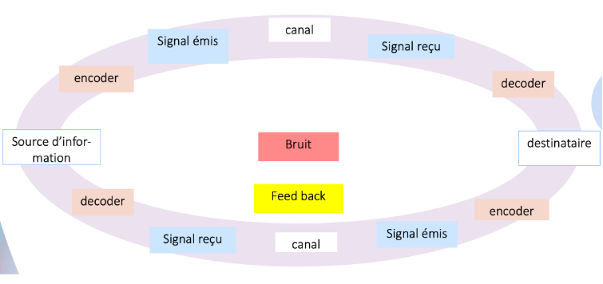

<style>
  .vertical {
    writing-mode: sideways-lr;
    text-orientation: mixed
  }
</style>
# R1.11 Expression & Communication

- Etudier:
  - Comprendre un métier, un esprit et une logique?
  - Apprendre des techniques
  - Comment allons-nous l'étudier
- Structure
  - Présentation des intervenants
  - Méthodes d'évaluation
  - Engagements respectifs
- Plan
  1. Introduction / communication
  2. Evolution des techniques et des médias
  3. Communication télégraphique
  4. Communication orchestrale
  5. Eléments de discours / rhétorique / éloquence
  6. Partiel
  7. Passage texte à oral
  8. Aides exposé
  9. Aides exposé
  10. Exposés
  11. Exposés

## 1. Introduction à la communication
Def communication:
1. Fait d'établir une relation avec quelqu'un ou quelque chose par un échange de signes ou de messages entre un émétteur et un récepteur.
2. Un échange d'informations entre différents organes (matérielles, logicielles, administration ou humain). Ex: 2. Un échange d'informations entre différents organes (matérielles, logicielles, administration ou humain). Ex: entre un citoyen et les Impôts.
3. Moyen technique par lequel les personnes communiquent. Ex: communiquer par mail, SMS, téléphone...
4. Ce qui permet de relier un point A à un point B dans l'espace.
5. Ensemble de technique médiatique, d'information et publicité.

Communication est très large:
- En France au XV<sup>e</sup> siècle: Communiquer = faire partager une nouvelle = transmettre
- Pays anglo-saxons XV<sup>e</sup> siècle: Communiquer = faire partager une nouvelle, transmettre objet de la communication. XVI<sup>e</sup> siècle+: industries de la presse, du cinéma, de la radio, de la télévision.

<div style="display: flex; justify-content: space-between;">
  <span class="vertical"></span>
  <span class="vertical">1632 Imprimerie</span>
  <span class="vertical">1789 Révolution Française</span>
  <span class="vertical">1870 1<sup>ère</sup> Révolution Industrielle</span>
  <span class="vertical">1914 1<sup>ère</sup> Guerre Mondiale</span>
  <span class="vertical">1920s Montée des fascismes</span>
  <span class="vertical">1939 2<sup>nde</sup> guerre mondiale</span>
  <span class="vertical"></span>
</div>

---

Fondamentaux théoriques:
- Mass communication research
- Communication télégraphique
- Communcation orchestrale

## 2. Evolution des techniques de communication
Les ancêtres du journal
- La curiosité du public
- Conteurs d'histoires
- Aèdes grecs
- Trouvères du Moyen Âge
- Griots africains

Problème de conservation des récits des grans évènements et de description des mondes étrangers (Homère, Marco Polo...)

Pour les besoins de leur administration, les grands comme les petits empires de l'Antiquité ou du Moyen Âge, réseaux réseaux de collect montante et de diffusion descendante d'information (correspondances privées).

### L'imprimerie
Nouvelles manuscrites


Nouvelles manuscrites: Avvisi, Venise
```ultree
.
    Occasionnels: petits cahiers de 4, 8 ou 16 pages, parfois illustrés de gravures sur bois, des veuilles de nouvelles racontant un événement important: bataille, funérailles princières, fêtes, etc.
    Canards: récit de faits surnaturels, de crimes, de catastrophes et de tous les évènements extraordinaires. Le plus ancien connu en France date de 1529.
    Libellés: feuilles volantes qui entretenaient les polémiques religieuses puis politiques
```

1631:
- Première publication périodique en France: la Gazette
- Son créateur: Théophraste Renaudot (1586-1653) journaliste et médecin français
- La Révolution française
  - Bouleverse le paysage et les structures de presse
  - De nouveaux titres voient le jour après 1789, il y en a près de 1500 en 1790
  - Modèle de pluralisme de la presse
- Le Gazetier reste au XVIII<sup>e</sup> siècle un personnage méprisé et l ejournalisme apparaît aux yeux de l'élite sociale et intellectuelle comme une sous-littérature sans valeur ni prestige.

### La radio
<div style="display: flex; justify-content: space-between;">
  <span class="vertical"></span>
  <span class="vertical">1920 Invention de la radioen tant<br/>que média grand public aux USA</span>
  <span class="vertical">1922 La radio fait ses premiers pas en France<br/>sous la double impulsion du public et du privé</span>
  <span class="vertical">Les premières émissions partent de la Tour Eiffel</span>
  <span class="vertical">1939 L'audience de la radio franchit les 5 millions</span>
  <span class="vertical">1980s Naissance des radios libres et rupture<br/>avec le monopole public sur l'audiovisuel</span>
  <span class="vertical"></span>
</div>
<br/>

Naissance de la communication de masse, publicités, etc.<br/>
Utilisation de la radio en propagande

ORTF: Office de Radiodiffusion-Télévision Française.<br/>
Développement de radios libes et des radios pirates

### La télévision
26 janvier 1926 première diffusion télévisuelle par l'écossais John Logie Baird à la Royal Institute.

<div style="display: flex; justify-content: space-between;">
  <span class="vertical">1926-29 Premiers pas de la TV sont anglo-saxons</span>
  <span class="vertical">En France l'initiative émane des PTT (postes,<br/>télégraphes et téléphones)</span>
  <span class="vertical">1932 Naissance des premières émissions de TV</span>
  <span class="vertical">1939 15h d'émissions par semaine et<br/>quelques centaines de spectateurs</span>
  <span class="vertical">1964 Création de l'ORTF</span>
  <span class="vertical">1984 Naissance de la première chaine<br/>de télévision privée: Canal+</span>
  <span class="vertical">1985 Nouvleles chaines de TV privées:<br/>la 5 et TV6 devenue M6 en 1987, année de création de TF1</span>
  <span class="vertical">La fin des années 80 voit la naissance de<br/>très grands groupes de communication:<br/>Bouygues, Vivendi, Lagardère Médias</span>
  <span class="vertical"></span>
</div>

### Communication de masse
Ecole de Columbia et le paradigme des effets limités
- **Merton** et **Gaudet**, **Lazarsfeld**: un élément intermédiaire entre le point initial et le point final du processus de communication
- Deux études, publiées dans *The People's Choice* (1944) et *Personal Influence: the part played by people in the Flow of Mass Communication* (**Lazarsfeld**, **Katz**, 1955)
- C'est la théorie du *two step flow of communication* (communication à double étage)


Les **leaders d'opinion** sont des individus qui sont exposés aux médias, qui vont ensuite filtrer et interpréter l'information selon différents prismes et qui vont transmettre l'information à un public large.

Ces stratégies de persuasion, visant à changer les habitudes de cuisine des maîtresses de maison, la notion de *gatekeeper* ou de contrôleur d'information et de compléter la notion de leader d'opinion informel.<br/>
**Kurt Lewin** va récupérer les travaux de Lazarsfeld et les pousser plus loin. Il va utiliser les méthodes de commercialisation pour faire passer des informations. On parle donc de *leader d'opinion informel*.

*Gatekeeper: "Gardien de la porte", "contrôleur de l'information", personne par laquelle passe l'information (ex: Google).*

### L'explosion technologique
Le **minitel** dans les 80's et 90's

**Internet**: L'accès à internet est obtenu grâce à un fournisseur d'accès à internet via différents moyens de communication éléctronique: réseau téléphonique, ADSL, fibre optique, etc. 55% de la population mondiale (4.2Md) utilise internet.

Bilan et perspectives: Une communication d'influence, au niveai des *mass media* avec une portée politique.

## 3. La communication télégraphique
### Notion très large
Le terme "communication télégraphique" est entré dans le langage courant fin XVIII<sup>e</sup> début IXX<sup>e</sup> siècle et ce terme désigne globalement la transmission des messages (le télégramme) d'un point géographique A à un point géographique B par l'utilisation d'une machine a code.

### De l'émetteur au destinataire
- Warren Weaver
- Norbert Wiener

Plusieurs chercheurs universitaires vont schématiser le fonctionnement de la communication, et il existe différents modèles. Parmis eux: **Claude Elwood Shannon**, ingénieur électricien à *Bell Telephone Laboratories* et **Warren Weaver**, philosophe et mathématicien. Ils ont été engagés pendant la 2<sup>nde</sup> guerre mondiale pour décrypter les codes ennemis et vont plus tard élaborer la première modélisation de la communication entre machines clair et simple: le schéma de **Claude Shannon**, parfois utilisé pour structurer la communication humaine.
Ils publient en 1948 *The Mathematical Theory of communication*.


Ils vont introduire la notion de "bruit" afin de déterminer le phénomène de "brouillage" des messages pendant la 2<sup>nde</sup> guerre mondiale.

- La source énonce un message
- Le message est codé par un Emetteur et transformé en signal
- Le signal est acheminé par un canal qui peut être brouillé
- La récepteur va décoder le signal et reconstituer le message et transmis au destinataire

Si ce schéma est encore enseigné aujourd'hui, il n'en reste pas moins trop simpliste et incomplet pour détailler la communication humaine, affirmé par **Shannon**. Depuis 1949, de nombreux travaux vont mettre en évidence des travaux plus adaptés à la communication humaine.

### La conception cybernétique de Wiener
- Norbert Wiener
- Professeur de C. Shannon, Ingénieur
- Chargé de travailler sur l'ajustement des tirs de la DCA
- Découvre le phénomène de feed-back
- 1948: *Cybernetics or control and communication in the Animal and Machine*

Selon Norbert Wiener, le conflit de la 2<sup>nde</sup> s'explique en grande partie par un problème de communication. Il va proposer de combler ce déficit de communication entre différents acteurs de la guerre en faisant intervenir des intelligences artificielles.

Le schéma de communication de Wiener de celui de Claude Shannon et Warrent Weaver. Il n'est pas linéaire mais circulaire et introduit la notion de "feedback" (rétroaction).



Wiener adopte une approche cybernétique dans son étude de la communication, c'est-à-dire qu'il analyse globalement le système en s'intéressent à tous les éléments engagés et à leur interaction.

L'action d'un élément sur un autre entraine en retour une réponse de la part du deuxième élément sur le premier.

Il existe deux types de feedback: positif qui conduit à accentuer le phénomène et le négatif qui aboutit à une régulation ou un amortissement du phénomènes.

1. Le **référent**: C'est le sujet du message, ce dont on parle.
2. Le **contexte**: C'est l'environnement dans lequel a lieu la communication: le lieu, le moment, l'activité.
3. Le **récepteur**: C'est celui qui reçoit le message, qui le lit, qui l'entend: un client.
4. Le **code**: Le message est codé l'émetteur et décodé par le récepteur. Il faut connaître le code pour comprendre le message.
5. Le **message**: C'est l'information transmise selon une certaine forme, ce qui est écrit, ce qui est dit.
6. Le **canal**: C'est le support du message entre l'émetteur et le récepteur, le terme en latin *medium* qui signifie 'intermédiaire'.
7. L'**émetteur**: C'est celui qui envoie le message, qui écrit, qui parle

### Théorie de la communication à deux étages (two-step flow of communication)

## 4. Communication orchestrale
Il existe des codes:
  - Couleurs
  - Odeurs
  - Procémiques
  - Kinésiques
  - Temporels
Ils forment l'univers culturel d'un individu

Des chercheurs en sciences sociales vont décider de prendre le contrepied de ces théories et ils vont considérer que chaque situation de comminucation va nécessiter un modèle propre pour illustrer sa complexité. Ces chercheurs vont donc parler de *communication orchestrale*

La **communication orchestrale**: la communication dans son ensemble et elle ne se limite pas a un échange verbale, elle intègre tout les signaux partagés lors d'une situation de communication entre deux humains: la voix, l'intonation, les gestes, le non verbal.

Ainsi ces chercheurs communiquer revient a rentrer dans l'orchestre, chacun en lisant et jouant sa partition, participe à une symphonie.

--- 
Affligem

Bière artisanale

Abbaye, histoire, rusticité

Texte prévention alcool illisible

Accessible

Vient de l'abbaye "Affligem"
